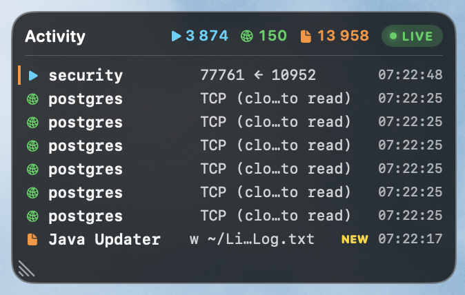
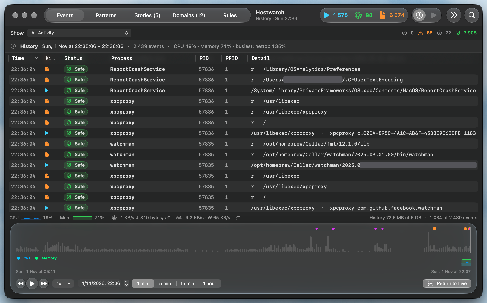

<p align="center">
  
</p>

<h1 align="center">Hostwatch</h1>

<p align="center">
  Behavior-based intrusion detection for macOS.<br>
  Learns what's normal on your Mac, flags what isn't, connects small signs into a story,<br>
  and can stop unknown connections and risky Claude Code commands.
</p>

<p align="center">
  
  
  
  
  <a href="https://vshymanskyy.github.io/StandWithUkraine/"></a>
</p>

<p align="center">
  
</p>

<p align="center">
  
</p>

---

## Why

An app starting a shell, a file landing in Downloads, a connection to a new server: each is normal on its
own. Attacks are **chains** of such steps. Hostwatch watches processes, files and connections, learns
what's normal on your Mac, and shows only what's new or suspicious, linked into the story of what happened.

It detects and explains, and if you turn them on, its firewall and Claude Code guard stop what you didn't
allow. It never deletes anything.

## What it does

**👀 See what happens**
- **Live HUD** – new processes, connections and file opens as they happen.
- **Time Travel** – scrub back through recorded activity, resources and heavy processes.
- **Heavy processes** – programs you started that keep eating CPU or memory stand out (and miners score).

**🧠 Learn what's normal**
- **Baseline** – the first hour learns your Mac: one rule per trusted app, nothing unsigned or downloaded.
- **Patterns** – events grouped by behaviour; ordinary ones are decided automatically, so few need you.
- **Rules tab** – *Needs You* (what's left for you), *Rules* (what decides automatically), *Decisions* (who decided what).

**🚨 Spot what's wrong**
- **Stories** – related suspicious steps become one story you can open event by event.
- **Network signals** – hostnames, first-seen domains, beaconing, raw-IP connections.
- **Known threats** – daily public threat lists, matched on your Mac; plus exploited macOS flaws vs. your updates.

**🛡️ Stop what you didn't allow** (off until you turn it on)
- **Firewall** – each app's new connections checked before they're made: allowed ones pass, unknown ones wait
  while a window asks **Allow / Block** (*Ask*), or are refused (*Strict*). *Watch* only shows what it would do.
- **Claude Code guard** – Claude Code's commands checked before they run: the dangerous blocked, the risky
  need your OK.

**✨ Ask AI**
- **AI suggests, you decide** – on-device model or Claude; it never trusts high-risk code, python or bash.
- **Ask Claude** – about any event or domain, or right in a firewall question: what it is, the risks, what to do.
- **MCP** – let Claude Code investigate your history (read-only).

## Install

1. Download `Hostwatch-<version>-macOS-universal.zip` from
   [Releases](https://github.com/everythings-gonna-be-alright/Hostwatch/releases), unzip, move
   `Hostwatch.app` to `/Applications`.
2. It isn't notarized: allow it in **System Settings → Privacy & Security → Open Anyway**.
3. Open it. A short setup window helps you turn on **Full Disk Access**.
4. Enter your administrator password to start the collector. Done.

Or build it: `./scripts/build-app.sh && open dist/Hostwatch.app` (Xcode 26 or the Command Line Tools).

**Requirements:** macOS 26+. Optional: Apple Intelligence (on-device AI),
[Claude Code](https://claude.com/claude-code) (Claude AI and MCP).

## How it works

```
collector (root)                       Hostwatch.app (you)
eslogger · tcpdump · NetworkStatistics ─► patterns · baseline · stories · domains
firewall relay (pf)  ◄── Allow/Block ── HUD · window · Time Travel · Ask AI · MCP
          verified Unix socket
```

The collector is built into the app. It only observes, unless you turn on the firewall: then it also relays
your apps' new connections through itself (macOS's own pf, no extension or paid entitlement needed).
Everything stays on your Mac, except what you send to Claude and a daily update check (both optional).

## Privacy

- History, patterns and stories stay in `~/Library/Application Support/Hostwatch` and `~/Library/Logs/Hostwatch`.
- Passwords and tokens are masked before they're recorded, and again before anything goes to an AI.
- The firewall reads only which server an app asks for. It never decrypts traffic.
- *Apple On-Device* AI keeps everything on the Mac; Claude is used only if you choose it.
- The MCP server needs your permission and a token, and can't change anything.
- *Settings ▸ General ▸ Reset Hostwatch…* erases it all.

## Limitations

A working prototype, not a commercial product. It uses Apple's `eslogger` (a prototyping tool), the
collector asks for your password at each start, and the optional process hold is best effort. The firewall
covers your own apps, not programs running as root or macOS's own DNS lookups.

## Development

```bash
./scripts/test.sh       # all tests
./scripts/package.sh    # tests + universal build + zip
```

`src/hostwatch` is the app and collector, `tests/swift` the tests. Every rule, threshold and setting is
in **[docs/reference.md](docs/reference.md)**; changes in **[CHANGELOG.md](CHANGELOG.md)**.

## License

[MIT](LICENSE)
