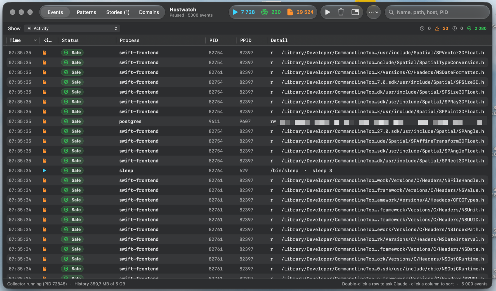

<p align="center">
  
</p>

<h1 align="center">Hostwatch</h1>

<p align="center">
  Behavior-based intrusion detection for macOS.<br>
  Learns what's normal on your Mac, flags what isn't, and connects small signs into a story.
</p>

<p align="center">
  
  
  
  
</p>

<p align="center">
  
</p>

<p align="center">
  
</p>

<p align="center"><sub>The floating HUD (top) and the Activity window with its Events, Patterns, Stories and Domains tabs.</sub></p>

---

## Why

Most of what happens on a Mac is boring, and that is the point. An app spawning a shell, a file landing
in Downloads, a connection to a new server: each of these is normal on its own. Attacks are **chains** of
such steps. Hostwatch watches processes, files and network connections, learns your Mac's normal
behaviour, and shows you only what is new or suspicious, ideally already connected into the story of
what happened.

It is a personal **HIDS** (host-based intrusion detection system): it detects and explains, it does not
block anything.

## Features

- **Live HUD.** A small Liquid Glass overlay shows new processes, connections and file opens as they
  happen, with badges for anything new or worth a look. Move it, resize it, or make it click-through.
- **Learns normal, surfaces the strange.** Events are grouped into patterns ("Slack → reads its own
  data", "curl → connects to the internet"). Routine patterns are marked safe automatically, so the
  list of new patterns stays short. Each new one gets a risk level.
- **Code signing aware.** Apple and trusted developers doing everyday things are routine. Unsigned code
  from Downloads or temp folders, modified binaries and binaries **replaced** at a known path are high
  risk.
- **Stories.** Suspicious steps are added up along the process tree. *Chrome downloads a file →
  quarantine removed → it runs → installs a LaunchAgent → calls home* becomes one **Dangerous** story
  instead of five unrelated rows.
- **Network signals.** Hostnames for every connection (from DNS answers), **first-seen domains**,
  **beaconing** (steady "calling home" intervals) and **raw-IP connections** on unusual ports.
- **Your choice of AI.** Apple's **on-device** model (free, offline, nothing leaves the Mac), **Claude**,
  or on-device first with Claude for the rest (default). It classifies new patterns; high-risk patterns
  are never marked safe on-device.
- **Ask AI.** Double-click anything for a verdict and an explanation, from Claude or the on-device model.
  The evidence includes the code signature, parent chain, command line and connections.
- **A real Mac app.** Native tables you can sort, a Stories timeline, a Domains inventory, filters,
  exclusions, recorded history.

## How it works

```
 ┌──────────────── collector (root, read-only) ────────────────┐
 │ eslogger (Endpoint Security)   new processes, file opens    │
 │ tcpdump  (pktap)               DNS answers, connection SYNs │
 │ lsof · nettop                  connections, traffic stats   │
 └──────────────────────────┬──────────────────────────────────┘
                            │ JSON lines on 127.0.0.1
 ┌──────────────────────────▼──────────────────────────────────┐
 │ Hostwatch.app (your user)                                    │
 │ patterns + risk → code signing → stories → domains/beacons  │
 │ HUD · Activity window · Ask Claude · history on disk        │
 └─────────────────────────────────────────────────────────────┘
```

The collector is a small Python script bundled in the app and started with your administrator
password. It only observes; nothing is blocked or modified. Everything stays on your Mac unless you
ask Claude about an event.

## Requirements

- macOS 26 or later
- Xcode 26 or the Command Line Tools (`xcode-select --install`), Swift 6.2+
- Python 3 (the system `python3` is fine)
- An administrator password, and Full Disk Access for the app
- Optional: Apple Intelligence turned on (Apple Silicon), for private on-device triage
- Optional: [Claude Code](https://claude.com/claude-code) (`claude` CLI) for Ask Claude and escalations

## Install

**Download:** get `Hostwatch-<version>-macOS-universal.zip` from
[Releases](https://github.com/everythings-gonna-be-alright/Hostwatch/releases) (Apple Silicon and
Intel), check it against the `.sha256` file, unzip, and move `Hostwatch.app` to `/Applications`.
The app is ad-hoc signed and **not notarized by Apple**, so macOS blocks the first launch. Allow it in
**System Settings → Privacy & Security → "Hostwatch was blocked…" → Open Anyway**.
The collector uses `/usr/bin/python3`, which needs the Command Line Tools (`xcode-select --install`).

**Or build from source:**

```bash
git clone https://github.com/everythings-gonna-be-alright/Hostwatch.git
cd Hostwatch
./scripts/build-app.sh
open dist/Hostwatch.app
```

Then, either way:

1. Open **System Settings → Privacy & Security → Full Disk Access**, add `Hostwatch.app` and turn it on.
   The app checks this and shows a guide if it's missing.
2. Hostwatch asks for your administrator password to start its collector.
3. The 〰 icon appears in the menu bar, and the HUD starts showing activity.

Builds are ad-hoc signed, so each rebuild needs Full Disk Access granted again. To avoid that, build
with a stable identity: `CODESIGN_IDENTITY="Apple Development: you@example.com (TEAMID)" ./scripts/build-app.sh`.

## First run

- **The first 12 hours are a learning period** for domains: whatever your Mac normally talks to becomes
  the baseline. Patterns are learned continuously; routine ones are marked safe automatically.
- Open the **Activity Window** (⌘O) from the menu bar. Its tabs:
  - **Events:** the live stream.
  - **Patterns:** what has been learned.
  - **Stories:** suspicious chains.
  - **Domains:** where your apps connect.
- Use **Show → Only Important** to see only flagged patterns, new high-risk activity, new domains,
  beacons and raw-IP connections.
- Right-click to mark patterns safe or suspicious, trust a developer, or add exclusions.

## Privacy and security

- **Local by default.** Events, patterns, stories and history stay in `~/Library/Application Support/Hostwatch`
  and `~/Library/Logs/Hostwatch`. The collector listens on `127.0.0.1` only.
- **You choose the AI** in *Detection ▸ AI Engine*. With *Apple On-Device*, nothing ever leaves the Mac
  (Apple's on-device model only, never its cloud model).
- **Claude only when chosen.** Evidence goes to Claude when you ask with Claude selected (you can review
  and edit it first) or when the engine includes Claude for classification (pattern summaries).
  Obvious secrets are masked either way.
- **Command lines are recorded.** Obvious secrets (tokens, passwords, URL credentials) are masked by
  the collector, but other secrets passed as arguments can end up in history.
- **The collector runs as root.** Keep the app somewhere only you can write to (e.g. `/Applications`).
- **Detection only.** Hostwatch never blocks, kills or deletes anything.

## Limitations

This is a working prototype, not a commercial security product.

- It relies on Apple's `eslogger`, which Apple documents as a prototyping tool whose output format may change.
  A production version would use a signed Endpoint Security system extension.
- Very short connections hidden by other security software are inferred from traffic statistics, with less detail.
- Anything that happens during the learning period becomes part of the baseline.
- No response actions yet (stop process, quarantine file).

## Development

```
src/hostwatch/     the app (Swift, SwiftUI + AppKit)
agent/             the collector (Python)
tests/             Swift Testing (tests/swift) and unittest (tests/agent)
scripts/           build, test, icon, git hooks
docs/reference.md  detailed rules, thresholds and behaviour
CHANGELOG.md       what changed in each version
```

```bash
./scripts/test.sh                 # all tests: Swift + collector, ~10 s
./scripts/package.sh              # tests, universal build, dist/Hostwatch-<version>-macOS-universal.zip
```

Merges are gated: `git config core.hooksPath scripts/hooks` enables a pre-merge hook that refuses a merge
when tests fail. Developer tools are built into the app binary:

```bash
.build/release/Hostwatch --signature-report <history.jsonl>   # how events group into patterns
.build/release/Hostwatch --story-replay <history.jsonl>       # which stories/domains/beacons would fire
.build/release/Hostwatch --signing-check <binary>…            # signer, trust and swap verdict
```

See **[docs/reference.md](docs/reference.md)** for every rule, threshold and setting.

## License

[MIT](LICENSE)
